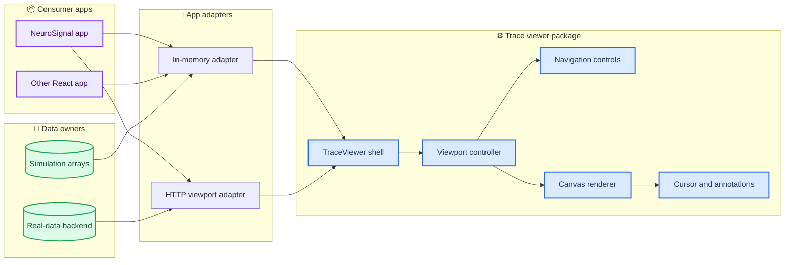
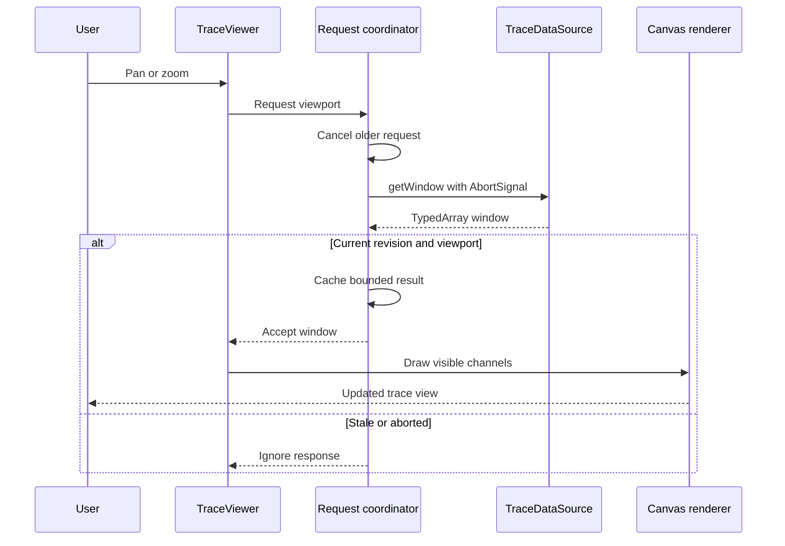

# NeuroSignal Trace Viewer 독립 저장소 구현 계획

_Draft v0.1 · 2026-09-04 · MNE에서 검증된 탐색 경험을 web-native 재사용 패키지로 구현하기 위한 개발 계약_

---

## 📋 결정과 배경

### 최종 결정

EEG trace viewer를 현재 앱의 `components/` 폴더에 한정하지 않고, 별도의 저장소에서 개발하는 독립 React/TypeScript 패키지로 만든다.

| 항목 | 결정 |
| --- | --- |
| 저장소 이름 | `neurosignal-trace-viewer` |
| npm 패키지 이름 | `@neurosignal/trace-viewer` |
| 주 프레임워크 | React + TypeScript |
| 기본 렌더러 | Canvas 2D |
| 초기 호환 렌더러 | SVG |
| 패키지 형식 | ESM + TypeScript declarations + 별도 CSS export |
| MNE 의존성 | 런타임 의존성 없음 |
| 백엔드 의존성 | 없음; `TraceDataSource` adapter로 격리 |
| 초기 배포 상태 | `0.x` pre-release, private consumption 우선 |

현재 `Neurosignal-Testbed`의 `StackedEegBrowser.tsx`는 8채널·12초 시뮬레이션을 표시하는 유효한 시각 프로토타입이다. 하지만 다음 제약 때문에 장시간 real EEG를 다루는 공용 viewer의 기반으로 그대로 확장하지 않는다.

- 모든 시간 좌표와 채널 값을 한 번에 JavaScript 배열로 받음
- 모든 채널과 sample을 하나의 SVG에 직접 렌더링함
- 시간 viewport, channel viewport, cursor, selection 상태가 없음
- 전체 데이터 최대값에만 의존하는 amplitude scaling을 사용함
- channel type, unit, bad 상태, montage 위치를 표현하는 모델이 없음
- before/after 비교가 단일 trace 렌더링과 별도 구현으로 중복됨
- NeuroSignal real-data API에는 viewport 단위 trace 요청 계약이 아직 없음

따라서 기존 구현은 폐기 대상이 아니라 첫 번째 `SvgTraceRenderer`와 visual characterization fixture로 이관한다. 새 패키지의 public API는 real data와 다른 앱에서의 재사용을 기준으로 새로 설계한다.

### 핵심 원칙

1. MNE-Python 코드를 포팅하지 않고, 유용성이 검증된 interaction과 표시 개념을 TypeScript로 재구현한다.
2. viewer는 데이터를 읽거나 저장하는 주체가 아니라, 제공된 viewport를 표시하고 사용자의 의도를 이벤트로 반환하는 주체다.
3. 원본 EEG는 viewer가 절대 수정하지 않는다.
4. 긴 recording 전체를 React state나 JSON payload로 보관하지 않는다.
5. 시간 이동, 채널 이동, cursor, segment selection을 서로 다른 상태로 모델링한다.
6. 비교 화면은 별도 viewer가 아니라 동일한 renderer의 multi-layer mode로 구현한다.
7. 렌더링 기술은 교체 가능하게 만들고 public API에 SVG, Canvas, WebGL 세부사항을 노출하지 않는다.

## 🎯 목표와 비목표

### 제품 목표

`@neurosignal/trace-viewer`는 다음 사용 사례를 하나의 컴포넌트 계약으로 지원해야 한다.

- 짧은 simulated EEG 전체 표시
- 수십 분 이상의 real EEG window 탐색
- 수십~수백 채널의 vertical navigation과 channel selection
- event와 annotation이 포함된 raw trace 검토
- time cursor와 분석 구간 선택
- 전처리 전후 또는 조건 A/B의 locked-scale 비교
- bad-channel 후보 검토
- 다른 React 앱에서 backend 종류와 무관한 재사용

### 기술 목표

| 목표 | 기준 |
| --- | --- |
| 독립성 | NeuroSignal 앱, FastAPI, MNE 객체를 import하지 않음 |
| 확장성 | renderer와 data source를 public API 변경 없이 교체 가능 |
| 성능 | 보이는 시간·채널 범위만 요청하고 렌더링함 |
| 정확성 | sample 시간, unit, NaN gap, annotation 범위를 왜곡하지 않음 |
| 안전성 | 사용자 동작은 intent event이며 source data를 직접 mutate하지 않음 |
| 접근성 | Canvas 외부에 keyboard 및 screen-reader용 semantic UI 제공 |
| 배포성 | `npm pack` 결과를 별도 consumer 앱에서 설치·빌드 가능 |

### 명시적 비목표

초기 `1.0` 범위에 다음 기능을 포함하지 않는다.

- MNE `Raw`, FIF, EDF, BDF 파일을 브라우저 패키지에서 직접 읽기
- filtering, re-referencing, projection, ICA 같은 과학 계산 수행
- 원본 파일 또는 derivative file 저장
- 의료 판정, 자동 artifact 판정 또는 자동 bad-channel 확정
- 완전한 MNE Qt Browser 복제
- React 이외 프레임워크용 wrapper
- 실시간 acquisition과 WebSocket streaming
- 모바일 화면을 주 분석 환경으로 지원

> 📌 **경계:** viewer는 display와 interaction 패키지다. 과학 연산, 파일 I/O, provenance, mutation 정책은 consumer 앱과 backend가 소유한다.

## ⚙️ 아키텍처와 패키지 경계

### 시스템 구조

새 저장소는 package, playground, contract fixtures를 함께 관리하는 작은 npm workspace로 구성한다.



### 책임 배분

| 영역 | 패키지 책임 | consumer 책임 |
| --- | --- | --- |
| 데이터 획득 | `TraceDataSource` 호출과 취소 | 실제 fetch, file, cache 구현 |
| 시간 탐색 | viewport 계산과 UI | recording metadata 제공 |
| 채널 탐색 | 선택, 검색, virtualized viewport | channel metadata 제공 |
| amplitude | display gain과 scale bar | 올바른 unit 제공 |
| selection | 범위 생성과 callback | crop, epoch, 분석 실행 여부 결정 |
| bad channel | 상태 표시와 intent callback | 검증, 저장, undo, provenance |
| annotation | 표시와 edit intent | validation과 persistence |
| 비교 | layer 정렬과 locked scale | 비교 가능한 source 제공 |
| 과학 처리 | 수행하지 않음 | MNE 또는 별도 backend에서 수행 |

### 내부 모듈 경계

```text
packages/trace-viewer/src/
├── index.ts                    # 의도적으로 작은 public export
├── model/
│   ├── channel.ts              # 채널 및 unit 모델
│   ├── trace-data.ts           # point/envelope window 모델
│   ├── viewport.ts             # time/channel viewport
│   ├── selection.ts            # cursor/segment/channel selection
│   └── capabilities.ts         # source별 읽기/쓰기 capability
├── data-source/
│   ├── TraceDataSource.ts      # backend-neutral interface
│   ├── createArrayTraceSource.ts
│   ├── request-coordinator.ts  # AbortController와 stale response 차단
│   └── viewport-cache.ts       # revision-aware bounded cache
├── state/
│   ├── trace-viewer-reducer.ts
│   ├── useTraceViewer.ts
│   └── invariants.ts
├── components/
│   ├── TraceViewer.tsx
│   ├── TraceToolbar.tsx
│   ├── ChannelNavigator.tsx
│   ├── TimeOverview.tsx
│   ├── ScaleBar.tsx
│   └── TraceStatus.tsx
├── renderers/
│   ├── TraceRenderer.ts
│   ├── CanvasTraceRenderer.tsx
│   ├── SvgTraceRenderer.tsx
│   └── draw/
│       ├── axes.ts
│       ├── traces.ts
│       ├── annotations.ts
│       └── hit-testing.ts
├── interactions/
│   ├── pointer.ts
│   ├── keyboard.ts
│   ├── time-selection.ts
│   └── channel-selection.ts
├── accessibility/
│   ├── semantic-summary.tsx
│   └── live-region.tsx
├── styles/
│   ├── tokens.css
│   └── trace-viewer.css
└── testing/
    ├── fixtures.ts
    └── contract-harness.ts
```

### 의존성 규칙

- `model/`은 React와 브라우저 DOM을 import하지 않는다.
- `data-source/`는 consumer의 URL, project ID, authentication을 모른다.
- `renderers/`는 fetch나 persistence를 수행하지 않는다.
- `components/`는 MNE, FastAPI, NeuroSignal lesson state를 import하지 않는다.
- `createArrayTraceSource()`만 작은 in-memory 데이터의 편의 adapter로 패키지에 포함한다.
- real-data HTTP adapter는 각각의 consumer 앱에 둔다.
- React와 React DOM은 `peerDependencies`로 두어 consumer와 하나의 runtime을 공유한다.
- 아이콘 패키지와 charting framework를 핵심 dependency로 추가하지 않는다.

## 📚 Public API와 데이터 계약

### Public export 원칙

`src/index.ts`는 안정적인 사용 표면만 노출한다. reducer, cache, renderer 내부 함수는 deep import를 허용하지 않는다.

```ts
export { TraceViewer } from './components/TraceViewer'
export { createArrayTraceSource } from './data-source/createArrayTraceSource'

export type {
  TraceAnnotation,
  TraceCapabilities,
  TraceChannel,
  TraceCursor,
  TraceDataSource,
  TraceLayer,
  TraceMetadata,
  TraceSelection,
  TraceViewerProps,
  TraceViewport,
  TraceWindow,
  TraceWindowRequest,
} from './model'
```

### Channel과 metadata

```ts
export type TraceChannelType =
  | 'eeg'
  | 'eog'
  | 'ecg'
  | 'emg'
  | 'stim'
  | 'misc'
  | 'source'
  | 'unknown'

export interface TraceChannel {
  id: string
  label: string
  type: TraceChannelType
  unit: string
  bad: boolean
  position?: {
    x: number
    y: number
    z?: number
    coordinateFrame?: string
  }
}

export interface TraceMetadata {
  sourceId: string
  revision: string
  title?: string
  startTimeS: number
  durationS: number
  samplingRateHz: number
  channels: readonly TraceChannel[]
  annotations: readonly TraceAnnotation[]
  capabilities: TraceCapabilities
}
```

`revision`은 cache invalidation과 stale-response 방지에 사용한다. channel ID는 label과 분리한다. label 변경이나 중복 label이 있어도 selection identity가 유지되어야 한다.

### Viewport와 selection

```ts
export interface TraceViewport {
  startTimeS: number
  durationS: number
  channelOffset: number
  visibleChannelCount: number
  gainByType: Partial<Record<TraceChannelType, number>>
}

export interface TraceCursor {
  timeS: number
  channelId?: string
}

export interface TraceSelection {
  startTimeS: number
  endTimeS: number
  channelIds?: readonly string[]
}
```

다음 상태를 합치지 않는다.

- `viewport`: 지금 화면에 보이는 시간과 채널 범위
- `cursor`: 단일 시점 또는 단일 trace inspection
- `selection`: downstream 작업의 후보가 되는 시간 구간
- `includedChannelIds`: viewer에 포함된 채널 집합
- `selectedChannelIds`: 강조하거나 다음 작업에 전달할 채널 집합

선택 범위가 만들어져도 viewport를 자동 확대하거나 데이터를 자동 crop하지 않는다. consumer는 `onSelectionChange`를 받은 뒤 별도의 명시적 동작을 제공한다.

### Data source

```ts
export interface TraceWindowRequest {
  sourceRevision: string
  startTimeS: number
  durationS: number
  channelIds: readonly string[]
  pixelWidth: number
  preferredRepresentation: 'auto' | 'points' | 'min-max'
}

export interface TraceDataSource {
  readonly id: string

  getMetadata(signal?: AbortSignal): Promise<TraceMetadata>

  getWindow(
    request: TraceWindowRequest,
    signal?: AbortSignal,
  ): Promise<TraceWindow>
}
```

`TraceDataSource`는 transport를 규정하지 않는다. consumer는 HTTP JSON, binary response, IndexedDB, local bridge 또는 in-memory array를 자유롭게 사용할 수 있다. 패키지가 받는 최종 sample은 `Float32Array` 또는 `Float64Array`여야 한다.

### Point와 min-max envelope

```ts
export type TraceSeries =
  | {
      representation: 'points'
      timesS: Float64Array
      values: Float32Array
    }
  | {
      representation: 'min-max'
      bucketStartTimesS: Float64Array
      minimum: Float32Array
      maximum: Float32Array
    }

export interface TraceWindow {
  sourceId: string
  sourceRevision: string
  startTimeS: number
  endTimeS: number
  channels: ReadonlyMap<string, TraceSeries>
  annotations: readonly TraceAnnotation[]
}
```

sample 수가 화면 pixel 수보다 작거나 비슷하면 `points`를 사용한다. sample 수가 훨씬 많으면 단순한 every-N decimation 대신 pixel bucket별 `minimum`과 `maximum`을 사용한다. 이렇게 해야 좁은 spike나 electrode pop이 중간 sample 선택 과정에서 사라지지 않는다.

### Multi-layer 비교

```ts
export interface TraceLayer {
  id: string
  label: string
  source: TraceDataSource
  visible?: boolean
  lineStyle?: 'solid' | 'dashed' | 'dotted'
  color?: string
}

export interface TraceViewerProps {
  layers: readonly TraceLayer[]
  viewport?: TraceViewport
  defaultViewport?: Partial<TraceViewport>
  selection?: TraceSelection | null
  onViewportChange?: (viewport: TraceViewport) => void
  onSelectionChange?: (selection: TraceSelection | null) => void
  onBadChannelIntent?: (channelId: string, bad: boolean) => void
  onAnnotationIntent?: (intent: TraceAnnotationIntent) => void
  readOnly?: boolean
  renderer?: 'canvas' | 'svg'
  className?: string
  ariaLabel: string
}
```

두 개 이상의 layer를 사용할 때 viewer는 channel ID, unit, time coordinate compatibility를 검증한다. 호환되지 않는 layer는 조용히 정렬하거나 resample하지 않고 명시적인 오류 상태를 표시한다. A/B 비교는 기본적으로 time axis와 amplitude scale을 잠근다.

## ⚡ 렌더링과 대용량 데이터 전략

### Viewport 요청 흐름



### 렌더링 계층

| 계층 | 기술 | 이유 |
| --- | --- | --- |
| Toolbar와 channel list | DOM/React | keyboard, focus, screen reader 지원 |
| Trace lines | Canvas 2D | 많은 path를 낮은 DOM 비용으로 렌더링 |
| Axis와 labels | DOM 또는 Canvas | 고정 label과 빠른 draw의 균형 |
| Cursor와 selection | Canvas overlay + semantic DOM | 빠른 pointer feedback와 접근성 |
| Annotation labels | DOM overlay | hover, focus, text overflow 처리 |
| Legacy visual parity | SVG renderer | 현재 prototype의 정확한 이관과 test fixture |
| 향후 고밀도 모드 | WebGL renderer | profiling으로 필요성이 확인된 뒤 추가 |

### Canvas 구현 규칙

- `devicePixelRatio`를 반영해 고해상도 화면에서 선명도를 유지한다.
- 한 viewport당 주 trace canvas와 interaction overlay canvas를 분리한다.
- channel row를 전부 DOM에 만들지 않고 visible range와 작은 overscan만 계산한다.
- pointer move에서는 전체 React render를 발생시키지 않는다.
- resize는 `ResizeObserver`로 감지하고 request animation frame에서 한 번만 반영한다.
- hidden tab에서는 animation과 prefetch를 중단한다.
- 값이 `NaN`이거나 unavailable이면 선을 연결하지 않고 gap으로 표현한다.
- trace가 row 범위를 넘을 때 `clamp`, `gap`, `overflow` display policy를 명시적으로 선택한다.
- 모든 scale bar는 실제 channel unit을 사용하며 unit을 추론하지 않는다.
- global maximum을 계산하기 위해 큰 배열을 spread하거나 복제하지 않는다.

### Cache와 prefetch

viewer cache는 source 전체를 보관하지 않는다. 다음 key로 최근 viewport만 제한적으로 저장한다.

```text
sourceId + revision + channelIds + startTimeS + durationS + pixelWidth
```

- 기본 cache budget은 entry 수와 byte 수를 함께 제한한다.
- 현재 viewport의 좌우 인접 window를 idle time에 한 개씩 prefetch할 수 있다.
- 빠른 연속 pan에서는 마지막 요청만 우선한다.
- source revision이 바뀌면 이전 cache를 재사용하지 않는다.
- annotation 또는 bad 상태 변경 후 data revision이 같더라도 metadata revision을 갱신할 수 있어야 한다.

### 성능 목표

목표는 특정 컴퓨터의 절대 수치를 보장하는 것이 아니라 regression을 탐지할 수 있는 reproducible benchmark를 만드는 것이다.

| 시나리오 | 초기 목표 |
| --- | ---: |
| 8채널 × 12초 in-memory | 최초 표시 100 ms 이내 |
| 64채널 × 10초 × 1,200 pixel envelope | Canvas draw p95 22 ms 이내 |
| channel scroll | 45 FPS 이상 유지 |
| cursor 이동 | pointer feedback p95 16 ms 이내 |
| local cached viewport | navigation 후 표시 p95 250 ms 이내 |
| viewer-owned cache | 기본 64 MB 이하 |

benchmark는 고정된 target Mac과 headless CI 결과를 분리해 기록한다. CI 수치는 pass/fail보다는 이전 baseline 대비 regression threshold로 사용하고, target Mac 측정치를 release gate로 사용한다.

### Backend 권장 계약

패키지는 transport를 강제하지 않지만 NeuroSignal adapter는 다음 형태의 endpoint를 권장한다.

```http
GET /real-data/projects/{project_id}/trace-window
    ?start_s=120.0
    &duration_s=10.0
    &channels=Fp1,Fp2,C3,C4
    &pixel_width=1200
    &representation=auto
```

응답은 metadata JSON과 binary Float32 payload를 분리하거나 multipart로 전달할 수 있다. 초기 구현에서 JSON을 사용할 경우에도 반환 sample 수를 pixel width에 의해 엄격히 제한하고, base64로 binary를 감싸지 않는다.

## 🔍 MNE 기능 채택 지도

MNE `Raw.plot()`은 시간 window, 표시 채널 수, channel picks와 grouping, scaling, annotation과 event, bad-channel marking, butterfly mode, overview, display decimation 등을 제공한다.[^1] 새 패키지는 이 기능을 동일 코드가 아니라 제품 요구에 맞춘 독립 interaction으로 구현한다.

| MNE 개념 | 패키지 결정 | 구현 방식 | 단계 |
| --- | --- | --- | ---: |
| `start`, `duration` | 채택 | time viewport + pan + preset duration | 2 |
| horizontal navigation | 채택 | wheel/drag/scrollbar + keyboard | 2 |
| time zoom | 채택 | zoom buttons, modifier wheel, range zoom | 2 |
| `n_channels` | 채택 | virtualized visible channel count | 2 |
| vertical channel scroll | 채택 | channel offset + scroll + page keys | 2 |
| `picks` | 채택 | search, type filter, explicit channel set | 2 |
| `group_by=type` | 채택 | stable type groups | 4 |
| position selection | 조건부 채택 | 좌표가 있을 때 scalp/lasso adapter | 5 |
| `scalings` | 채택 | common 또는 type별 gain + auto/manual | 2 |
| scale bars | 채택 | unit-aware visible scale bar | 2 |
| `butterfly` | 후순위 채택 | overlay mode, type별 grouping | 5 |
| annotations | 채택 | overlay, filter, read-only first | 3 |
| annotation editing | 수정 채택 | package는 intent만 emit | 4 |
| events | 채택 | marker, label, jump navigation | 3 |
| bad-channel click | 수정 채택 | intent + consumer confirmation/persistence | 3 |
| linked cursor | 확대 채택 | controlled cursor callback | 2 |
| segment selection | 확대 채택 | drag range + downstream intent | 2 |
| overview bar | 채택 | 전체 duration navigator | 3 |
| `remove_dc` | backend 책임 | viewer는 이미 제공된 값을 표시 | 제외 |
| high/low-pass display filter | backend 책임 | scientific transform request는 app이 소유 | 제외 |
| projector toggle | backend 책임 | 적용 상태 표시와 intent만 가능 | 5 |
| `decim=auto` | 수정 채택 | peak-preserving min-max envelope | 4 |
| precompute/OpenGL | 원칙만 채택 | cache + Canvas, 필요 시 WebGL | 5 |
| clock time format | 채택 | seconds/relative/clock formatter | 4 |
| zen mode | 선택 채택 | toolbar/overview visibility toggle | 5 |

### Keyboard interaction 초안

| 입력 | 동작 |
| --- | --- |
| `ArrowLeft` / `ArrowRight` | 작은 time step 이동 |
| `Shift` + horizontal arrow | 한 viewport 단위 이동 |
| `ArrowUp` / `ArrowDown` | channel focus 이동 |
| `PageUp` / `PageDown` | visible channel page 이동 |
| `+` / `-` | amplitude gain 조절 |
| `Alt` + `+` / `-` | time zoom 조절 |
| `Home` / `End` | recording 시작/끝으로 이동 |
| `Escape` | active selection 또는 interaction 취소 |
| `Enter` | focus된 channel 선택 toggle |

단축키는 editable element와 IME composition 중에는 동작하지 않는다. 플랫폼 기본 browser zoom이나 screen-reader shortcut을 가로채는 조합은 사용하지 않는다.

## 🔐 데이터 무결성, 접근성, 보안

### 원본 보호와 mutation intent

viewer는 기본적으로 `readOnly=true`다. 다음 동작은 내부 데이터를 변경하지 않고 intent만 consumer에 전달한다.

- bad-channel 표시 변경 요청
- annotation 생성·수정·삭제 요청
- segment crop 또는 epoch 생성 요청
- projection 또는 display-transform 변경 요청

consumer는 intent를 검증하고 derivative artifact 또는 project state에 반영한 다음 새 `revision`을 가진 metadata를 viewer에 다시 제공한다. 원본 recording은 immutable input으로 유지한다.

### 과학적 표시 무결성

- channel별 unit과 scale을 화면에 명시한다.
- 서로 다른 unit의 채널을 common gain으로 조용히 합치지 않는다.
- A/B layer는 channel identity와 time coordinate가 맞지 않으면 비교를 거부한다.
- display-only downsampling이 분석 데이터로 재사용되지 않도록 representation metadata를 유지한다.
- decimation 또는 envelope를 raw sample로 오인할 수 있는 export API를 제공하지 않는다.
- missing sample과 clipped sample을 서로 다른 상태로 표시한다.
- 자동 scale은 visible window인지 broader context인지 UI에 명시한다.
- annotation이 `bad_*` 의미를 갖더라도 viewer가 분석 제외를 자동 결정하지 않는다.

### 접근성 요구사항

Canvas 그림만으로 정보를 전달하지 않는다.

- viewer root에 명확한 `aria-label`을 요구한다.
- toolbar와 channel navigator는 완전한 keyboard focus 순서를 가진다.
- focus된 channel의 label, type, bad 상태, unit을 DOM text로 제공한다.
- cursor 값은 요청 시 읽을 수 있는 semantic readout으로 제공한다.
- pan 중 매 frame마다 live region을 갱신하지 않고 interaction 종료 시 요약한다.
- selected, bad, hidden 상태는 색뿐 아니라 선 모양, icon, label로 구분한다.
- minimum contrast와 forced-colors mode를 검증한다.
- `prefers-reduced-motion`에서는 inertial animation을 사용하지 않는다.
- zoom 200%에서도 toolbar와 channel labels가 잘리지 않아야 한다.

### Privacy와 logging

- package는 recording 이름이나 channel 값을 원격으로 전송하지 않는다.
- package는 analytics SDK를 포함하지 않는다.
- error 객체와 debug log에 sample 배열을 직렬화하지 않는다.
- consumer callback에 source path를 요구하지 않는다.
- 개발용 debug mode는 production build에서 기본 비활성화한다.

## 🧪 테스트 전략과 품질 게이트

### 테스트 계층

| 계층 | 도구 | 검증 대상 |
| --- | --- | --- |
| Pure unit | Vitest | viewport math, gain, ticks, hit testing, invariants |
| Reducer | Vitest | navigation, selection, stale response, controlled state |
| Component | React Testing Library | toolbar, keyboard, ARIA, callbacks |
| Canvas draw | deterministic draw-command tests | 좌표, gap, clipping, layer ordering |
| Data-source contract | shared harness | metadata/window/cancel/revision behavior |
| Browser E2E | Playwright | pointer drag, wheel, resize, focus, screenshots |
| Performance | browser benchmark | draw time, scroll FPS, cache size |
| Package consumer | temporary Vite app | tarball install, import, CSS, production build |

### 필수 fixture

- 8채널 × 12초 simulated blink EEG
- 동일 데이터의 before/after 2-layer 비교
- 64채널 × 60초 deterministic EEG
- 128채널 mixed-type recording
- EEG, EOG, ECG, stim channel이 섞인 metadata
- 한 채널의 매우 큰 transient spike
- `NaN` gap과 flat channel
- bad channel과 overlapping annotations
- recording 시작과 끝에 걸친 selection
- source revision이 navigation 중 변경되는 경우
- layer channel order가 다르거나 unit이 호환되지 않는 경우

### 정확성 불변조건

1. viewport는 recording 경계를 벗어나지 않는다.
2. `startTimeS < endTimeS`가 항상 유지된다.
3. cursor와 selection의 time mapping 오차는 최대 반 sample 이하다.
4. channel selection은 label이 아니라 stable ID를 사용한다.
5. stale 또는 aborted response는 현재 화면을 덮어쓰지 않는다.
6. `NaN` 구간을 가로질러 선을 연결하지 않는다.
7. min-max envelope는 각 bucket의 실제 extrema를 포함한다.
8. locked-scale comparison은 layer마다 다른 gain을 적용하지 않는다.
9. read-only mode에서는 mutation intent control을 숨기거나 비활성화한다.
10. unmount 후 observer, animation frame, request가 남지 않는다.

### 명령 기준

```bash
npm run typecheck
npm run lint
npm test
npm run test:browser
npm run test:performance
npm run build
npm pack --workspace @neurosignal/trace-viewer --dry-run --json
```

release candidate는 실제 tarball을 임시 consumer에 설치해 검증한다.

```bash
npm pack --workspace @neurosignal/trace-viewer
npm install ./neurosignal-trace-viewer-0.1.0.tgz --prefix ./tmp-consumer
npm run build --prefix ./tmp-consumer
```

### Definition of done

각 phase는 다음 조건을 모두 충족해야 끝난다.

- 해당 phase의 acceptance test가 추가되고 통과함
- `typecheck`, unit/component test, production build가 통과함
- public export 변경이 문서화됨
- 새 interaction의 keyboard 경로가 존재함
- 오류, empty, loading, unavailable 상태가 정의됨
- `git diff --check`가 통과함
- performance-sensitive 변경은 baseline 비교가 첨부됨
- consumer-facing 변경은 playground와 README 예제가 함께 갱신됨

## 📦 저장소, 구현 단계, 배포

### 권장 저장소 구조

```text
neurosignal-trace-viewer/
├── package.json                    # private workspace root
├── package-lock.json
├── tsconfig.base.json
├── eslint.config.js
├── README.md
├── LICENSE                         # public release 전에 확정
├── CHANGELOG.md
├── docs/
│   ├── IMPLEMENTATION_PLAN.md      # 이 문서
│   ├── MNE_FEATURE_MAP.md
│   ├── PERFORMANCE.md
│   ├── ACCESSIBILITY.md
│   └── decisions/
│       ├── 001-package-boundary.md
│       ├── 002-canvas-first-rendering.md
│       └── 003-data-source-contract.md
├── packages/
│   └── trace-viewer/
│       ├── package.json
│       ├── tsconfig.json
│       ├── tsconfig.build.json
│       ├── vite.config.ts
│       ├── src/
│       └── tests/
├── examples/
│   └── playground/
│       ├── package.json
│       ├── src/
│       └── fixtures/
├── scripts/
│   ├── check-package.mjs
│   └── benchmark.mjs
└── .github/
    └── workflows/
        ├── ci.yml
        └── release.yml
```

루트 `package.json`은 publish하지 않으며 workspace만 관리한다. npm workspaces는 nested package를 root에서 관리하고 workspace별 script 실행과 local linking을 지원한다.[^2]

```json
{
  "name": "neurosignal-trace-viewer-workspace",
  "private": true,
  "workspaces": [
    "packages/*",
    "examples/*"
  ],
  "scripts": {
    "build": "npm run build --workspaces --if-present",
    "typecheck": "npm run typecheck --workspaces --if-present",
    "test": "npm run test --workspaces --if-present"
  }
}
```

### 패키지 build와 exports

Vite library mode를 사용해 ESM과 CSS를 생성하고 React 계열 dependency는 bundle에서 externalize한다. Vite는 library entry와 별도 CSS filename을 지정하고, 생성된 CSS를 package export로 노출하는 방식을 지원한다.[^3]

```ts
import { resolve } from 'node:path'
import { defineConfig } from 'vite'
import react from '@vitejs/plugin-react'

export default defineConfig({
  plugins: [react()],
  build: {
    lib: {
      entry: resolve(import.meta.dirname, 'src/index.ts'),
      formats: ['es'],
      fileName: 'index',
      cssFileName: 'trace-viewer',
    },
    rolldownOptions: {
      external: ['react', 'react-dom', 'react/jsx-runtime'],
    },
  },
})
```

TypeScript declaration은 별도 `tsconfig.build.json`에서 `emitDeclarationOnly`로 생성한다. `dist` 정리 순서가 declaration을 삭제하지 않도록 Vite build 후 declaration build를 실행한다.

```json
{
  "name": "@neurosignal/trace-viewer",
  "version": "0.1.0",
  "type": "module",
  "files": ["dist", "README.md", "LICENSE"],
  "sideEffects": ["**/*.css"],
  "exports": {
    ".": {
      "types": "./dist/index.d.ts",
      "import": "./dist/index.js"
    },
    "./styles.css": "./dist/trace-viewer.css"
  },
  "peerDependencies": {
    "react": "^18.3 || ^19.0",
    "react-dom": "^18.3 || ^19.0"
  }
}
```

React version 범위는 새 저장소 bootstrap 시 실제 consumer matrix로 다시 검증한다. CJS build는 확인된 consumer 요구가 생기기 전에는 추가하지 않는다.

### CSS와 theming

- package selector는 `.nsv-*` namespace를 사용한다.
- 전역 element selector와 consumer reset을 사용하지 않는다.
- color, spacing, font, trace width는 `--nsv-*` CSS variables로 제공한다.
- 기본 theme는 light/dark 모두 제공하되 host가 token을 override할 수 있게 한다.
- line color를 consumer가 지정하지 않으면 channel type과 layer index를 함께 고려한다.
- `styles.css`는 명시적으로 import하며 JavaScript import만으로 global CSS를 강제하지 않는다.

### 구현 단계

#### 새 저장소 bootstrap 순서

다음 명령은 저장소를 실제로 만들 때 사용할 실행 순서다. 원격 저장소 URL과 Node/npm pin은 생성 시점의 환경에 맞춰 확정한다.

```bash
mkdir neurosignal-trace-viewer
cd neurosignal-trace-viewer
git init
npm init -y
npm pkg set name=neurosignal-trace-viewer-workspace
npm pkg set private=true --json
npm pkg set 'workspaces[0]=packages/*'
npm pkg set 'workspaces[1]=examples/*'
mkdir -p packages/trace-viewer/src examples/playground/src docs/decisions .github/workflows
```

bootstrap 직후 빈 package를 먼저 build하고 pack한다. 기존 NeuroSignal 파일은 이 baseline이 통과한 다음 복사한다.

```bash
npm install
npm run typecheck --workspaces --if-present
npm run test --workspaces --if-present
npm run build --workspaces --if-present
npm pack --workspace @neurosignal/trace-viewer --dry-run --json
```

> ⚠️ **주의:** `private=true`는 workspace root에만 설정한다. 실제 `@neurosignal/trace-viewer` package는 tarball 생성이 가능해야 하며, public publish 여부는 release policy로 통제한다.

#### Phase 0 — 저장소 bootstrap과 baseline

**목표:** 새 저장소와 build/test/release skeleton을 만들고 기존 화면을 이관하기 전 안전 기준을 확정한다.

**작업:** workspace, package, playground, CI, formatting, ADR 3개, deterministic fixtures를 만든다. 기존 `StackedEegBrowser` 화면을 screenshot과 DOM assertion으로 characterization한다.

**변하지 않아야 할 것:** 현재 NeuroSignal ICA 화면과 API는 건드리지 않는다.

**위험:** 낮음.

**검증:** 빈 package build, playground production build, tarball dry-run.

**롤백:** 새 저장소만 폐기하면 현재 앱에 영향이 없다.

#### Phase 1 — SVG prototype의 package extraction

**목표:** 현재 trace와 before/after 시각 결과를 `@neurosignal/trace-viewer`로 동일하게 재현한다.

**작업:** `SvgTraceRenderer`, `createArrayTraceSource`, core models, scale utility를 구현한다. before/after는 동일 renderer에 layer 두 개를 전달한다.

**변하지 않아야 할 것:** channel 순서, time ticks, common range, line style, ARIA label.

**위험:** 낮음.

**검증:** visual snapshot, 기존 ICA component test를 새 package consumer test로 복제, tarball playground build.

**롤백:** NeuroSignal은 기존 `StackedEegBrowser` import를 유지한다.

#### Phase 2 — 핵심 interaction

**목표:** time navigation, zoom, gain, channel viewport, cursor, segment selection을 제공한다.

**작업:** reducer와 invariants를 먼저 작성하고 toolbar, channel navigator, pointer/keyboard interaction을 연결한다. controlled와 uncontrolled state를 모두 지원한다.

**변하지 않아야 할 것:** source array와 consumer state는 viewer 동작만으로 변경되지 않는다.

**위험:** 중간.

**검증:** reducer property tests, keyboard component tests, pointer E2E, boundary selection tests.

**롤백:** interactive controls를 feature flag로 끄고 Phase 1 static mode를 유지한다.

#### Phase 3 — annotation, event, bad-channel intent

**목표:** real-data 검토에 필요한 context overlay와 안전한 review interaction을 추가한다.

**작업:** annotation lanes, event marker, jump navigation, bad-channel intent, read-only capability를 구현한다.

**변하지 않아야 할 것:** package는 원본과 derivative를 직접 저장하지 않는다.

**위험:** 중간.

**검증:** overlap, boundary, hidden label, keyboard, color-independent status tests.

**롤백:** mutation capability를 비활성화하고 read-only overlay만 유지한다.

#### Phase 4 — viewport data source와 Canvas 기본화

**목표:** 64채널 이상의 긴 recording을 전체 로드 없이 탐색한다.

**작업:** cancellable `TraceDataSource`, revision cache, min-max representation, Canvas renderer, virtualization, prefetch를 구현한다. contract harness를 공개 testing export로 제공한다.

**변하지 않아야 할 것:** 동일 viewport에서 SVG와 Canvas의 time/channel mapping이 일치한다.

**위험:** 높음.

**검증:** peak preservation oracle, stale-response race test, 64/128-channel benchmark, memory ceiling.

**롤백:** Canvas를 opt-in으로 되돌리고 SVG renderer와 point representation을 유지한다.

#### Phase 5 — NeuroSignal real-data 통합

**목표:** 독립 package를 실제 imported FIF workflow에 연결한다.

**작업:** NeuroSignal 저장소에 `RealDataTraceSource`와 trace-window endpoint를 구현한다. metadata inspection 후 생성된 derivative working copy만 source로 사용한다.

**변하지 않아야 할 것:** 원본 file hash와 bytes, 기존 import/QC/report 동작.

**위험:** 높음.

**검증:** MNE `Raw.get_data(start, stop, picks)` 결과와 viewport response 비교, original SHA-256 before/after 확인, integration/E2E test.

**롤백:** real-data 화면에서 viewer entry point만 숨기고 기존 metadata/QC UI를 유지한다.

#### Phase 6 — 확장 기능과 첫 안정 release

**목표:** grouping, overview, time format, butterfly mode를 추가하고 `0.x` API를 안정화한다.

**작업:** MNE feature map의 P1 항목, API review, accessibility audit, bundle analysis, changelog와 migration guide를 완료한다.

**변하지 않아야 할 것:** `TraceDataSource` 기본 계약과 read-only safety default.

**위험:** 중간.

**검증:** 두 개 이상의 consumer app, package tarball, visual matrix, target Mac benchmark.

**롤백:** 기능별 capability/flag로 비활성화하며 public core contract는 유지한다.

### 기존 NeuroSignal로 되돌려 연결하는 절차

Phase 1 package가 독립 playground에서 통과한 뒤에만 현재 앱의 구현을 교체한다.

1. 새 저장소에서 production build와 tarball을 만든다.
2. 임시 consumer가 tarball을 설치하고 중복 React 없이 build되는지 확인한다.
3. NeuroSignal 앱에 tarball을 설치하고 `@neurosignal/trace-viewer/styles.css`를 한 번만 import한다.
4. 기존 simulation response를 `createArrayTraceSource()` 입력으로 변환한다.
5. 현재 `StackedEegBrowser`와 새 `TraceViewer`를 fixture 기준으로 비교한다.
6. ARIA label, channel 순서, time ticks, shared gain이 동일한지 확인한다.
7. 기존 ICA test와 production build가 통과한 뒤에만 앱 내부 구현을 제거한다.
8. 문제가 생기면 package import만 되돌리고 기존 component를 유지한다.

real-data 연결은 이 migration과 분리한다. 정적 simulation viewer의 교체와 backend viewport endpoint 추가를 같은 commit에 넣지 않는다.

### Release 전략

| 단계 | 배포 방식 | 목적 |
| --- | --- | --- |
| `0.1.x` | local tarball | package boundary와 visual parity 검증 |
| `0.2.x` | Git tag 또는 private registry | 여러 앱에서 integration 검증 |
| `0.3.x`–`0.9.x` | pre-release cadence | interaction과 data-source API 안정화 |
| `1.0.0` | 검증된 registry release | public API stability 선언 |

첫 public release 전에 license와 package scope 소유권을 확정한다. MNE-Python은 BSD 3-Clause 라이선스이지만[^4], 이 프로젝트는 코드 복사 대신 기능 개념과 interaction을 독립 구현한다. 문서의 `MNE_FEATURE_MAP.md`에 참고한 기능과 차이를 기록한다.

### 현재 NeuroSignal에서 가져올 자산

| 자산 | 처리 |
| --- | --- |
| `StackedEegBrowser.tsx` | `SvgTraceRenderer`의 behavior reference로 복사 후 재구성 |
| `IcaWorkbench.test.tsx` | visual/DOM characterization fixture로 이식 |
| `.eeg-browser-*` CSS | package token으로 분해하고 `.nsv-*` namespace로 변경 |
| simulated 8-channel response | deterministic fixture로 변환 |
| before/after result | two-layer compatibility fixture로 변환 |
| app API client | 가져오지 않음 |
| NeuroSignal `types.ts` 전체 | 가져오지 않고 최소 viewer model만 새로 정의 |
| lesson/workbench state | 가져오지 않음 |

### 새 저장소 첫 작업 체크리스트

- [ ] 새 Git 저장소 `neurosignal-trace-viewer` 생성
- [ ] root private npm workspace 생성
- [ ] `packages/trace-viewer`와 `examples/playground` 생성
- [ ] Node와 npm version pin 파일 추가
- [ ] TypeScript strict options와 exact optional property 설정
- [ ] Vite library mode와 declaration build 구성
- [ ] Vitest, React Testing Library, Playwright 구성
- [ ] CI에 typecheck, lint, test, build, pack check 추가
- [ ] ADR 001–003 작성
- [ ] 현재 SVG viewer characterization fixture 이식
- [ ] `0.1.0` package tarball을 playground에서 설치 검증
- [ ] Phase 1 완료 전 interaction 기능 추가 금지

## 🔗 참고자료

[^1]: MNE-Python. “`mne.io.Raw.plot` API reference.” https://mne.tools/stable/generated/mne.io.Raw.html#mne.io.Raw.plot

[^2]: npm. “Workspaces.” https://docs.npmjs.com/cli/using-npm/workspaces

[^3]: Vite. “Building for Production — Library Mode.” https://vite.dev/guide/build.html#library-mode

[^4]: MNE-Python contributors. “BSD 3-Clause License.” https://github.com/mne-tools/mne-python/blob/main/LICENSE.txt

---

_이 문서는 새 저장소의 `docs/IMPLEMENTATION_PLAN.md`로 옮긴 뒤 구현 계약으로 사용한다. 각 phase가 완료될 때 실제 결정, benchmark, API 변경을 반영해 version을 갱신한다._
